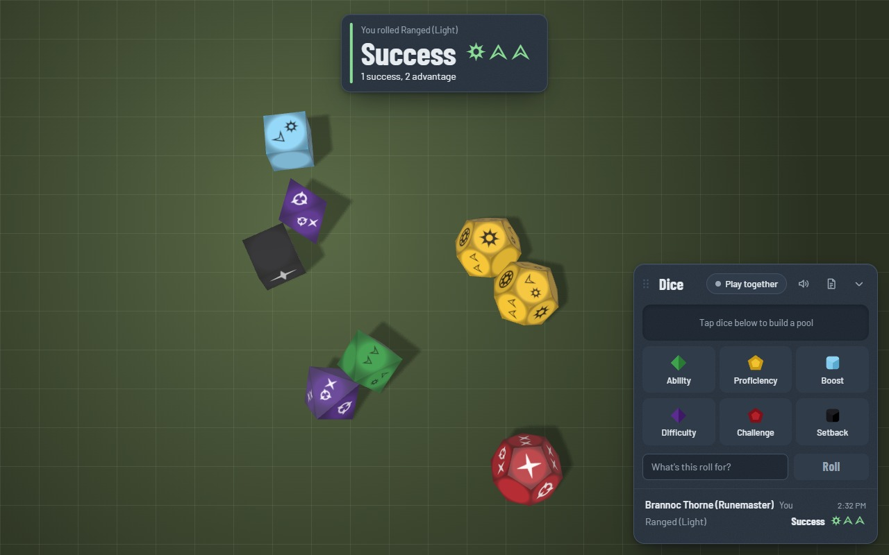
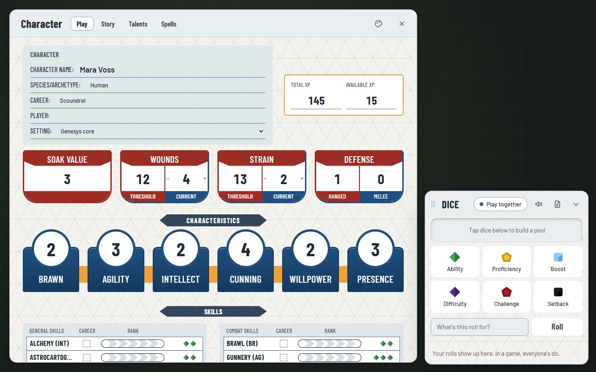
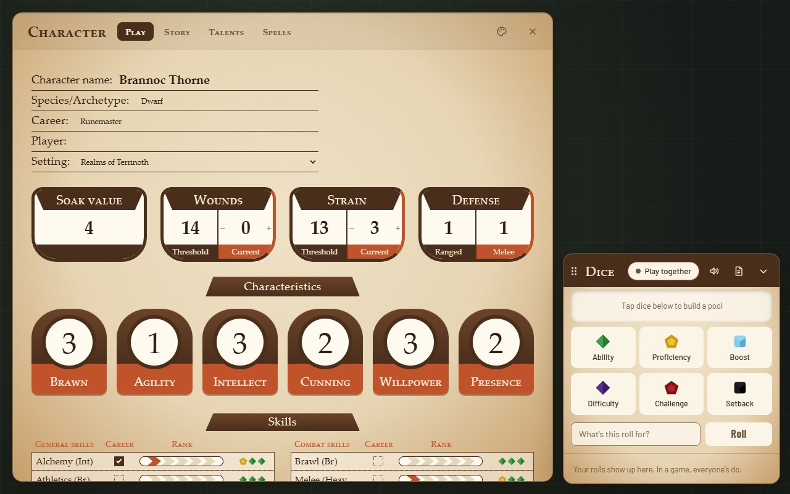
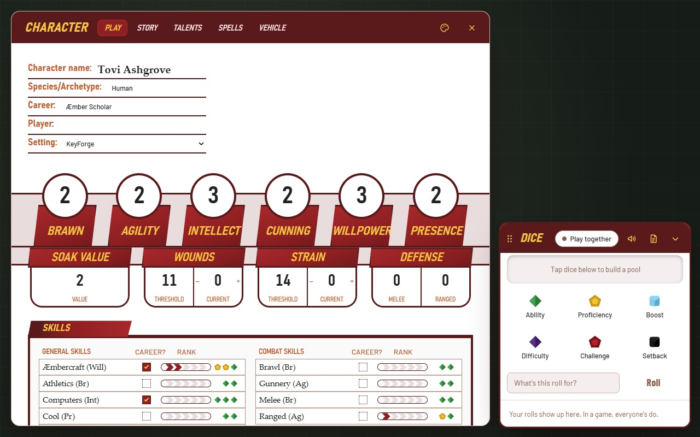

# genesys-overlay

Genesys RPG dice and character sheets as a Chrome extension overlay on your virtual tabletop. It runs on Alchemy RPG out of the box, and on any other tabletop you turn it on for. It handles dice and sheets only. The tabletop keeps maps, tokens and everything else.



Character sheets for Genesys core, Realms of Terrinoth and KeyForge, each with a theme in the style of its printed sheet:

<p>
  
  
  
</p>

Design doc: [Genesys Overlay: Dice, Sheet Styles & Tooling](https://claude.ai/artifact/KdWPHL6Js9pxaePVYTt2MM)

## Layout

| Path | What it is |
| --- | --- |
| `apps/extension` | Chrome MV3 extension: the overlay (dice tray, 3D dice, result card, shared roll feed) in a Shadow DOM over the tabletop, a background service worker for hosting, and a small script for invitation pages. |
| `packages/host` | GM host companion: runs a multiplayer session on the GM's computer and shares it through a Cloudflare Quick Tunnel. See [packages/host/README.md](packages/host/README.md). |
| `packages/shared` | Code both sides use: Genesys dice tables and roll math, the versioned multiplayer protocol, the character data model and setting definitions. |

There's no hosted backend. Without a game, rolls are practice and only you see them. Everything works offline.

## Getting started

Requires Node 20+ and pnpm 9.

```bash
pnpm install
pnpm test
pnpm dev:extension   # rebuilds apps/extension/dist on change
```

Load the extension: open `chrome://extensions`, turn on Developer mode, choose **Load unpacked** and pick `apps/extension/dist`. Its ID is `oompfooljghcchjdigpjicjdlncaaoki`, fixed by the `key` in `manifest.json`.

## Other tabletops

Alchemy RPG works without any setup. For another tabletop (Roll20, Owlbear Rodeo, a Foundry VTT server, and so on), open it, click the Genesys Overlay icon in Chrome's toolbar and choose **Turn on for this site**. Chrome asks once for that site only, and the overlay appears right away, then every time you visit. The same menu lists your sites and turns them off.

Under the hood, the extension asks for one site's permission at a time from its optional `https://*/*` host permission, and the background worker registers the overlay for exactly the sites granted (`apps/extension/src/sites.ts`).

## Playing together

1. **GM, once:** install the host companion (Windows, needs [Node.js 20+](https://nodejs.org)):
   1. Download `genesys-host-<version>.zip` from the [latest release](https://github.com/baysidejr/genesys-overlay/releases/latest) and unzip it.
   2. In the unzipped folder, run `powershell -ExecutionPolicy Bypass -File .\install-host.ps1`.
   3. Restart the browser.

   The zip's `README.txt` walks through it. To install from a clone of this repository instead, see [packages/host/README.md](packages/host/README.md).
2. **GM, each session:** in the dice tray, click **Play together**, choose **Host a game**, and send the invitation link to your players.
3. **Players:** open the link (the extension saves it), then choose **Join game** in the dice tray. Or paste the link there.
4. The GM approves each player. Rolls then land on the roller's screen and appear in everyone's feed.

Players don't need Node, cloudflared, accounts, port forwarding or firewall changes.

## Previewing without the tabletop

```bash
pnpm --filter @genesys/extension preview:dice
```

This shows the overlay over a stand-in map at http://localhost:5174. To try multiplayer there, start a local game with `pnpm host:local` and paste its invitation into **Join game**. Hosting from the tray needs the installed extension.

## Releasing the host companion

1. Bump `version` in `packages/host/package.json`, and check `$StoreExtensionId` in `packages/host/scripts/install-host.ps1` is filled in.
2. Run `pnpm package:host`. It writes `packages/host/release/genesys-host-<version>.zip` with the installer, uninstaller, host scripts and a README for GMs.
3. Create a GitHub release and attach the zip.

## Packaging the extension

1. Bump `version` in `apps/extension/public/manifest.json`.
2. Run `pnpm package`. It writes `apps/extension/release/genesys-overlay-<version>.zip`.

Share the zip for **Load unpacked**.

For the Chrome Web Store, run `pnpm package:store` instead. It writes `genesys-overlay-<version>-store.zip` without the manifest's `key`, which the store doesn't accept. The store assigns its own extension ID: put it in `$StoreExtensionId` in `packages/host/scripts/install-host.ps1` so the host companion accepts it. The listing text, permission justifications and checklist are in [docs/store-listing.md](docs/store-listing.md), and the privacy policy draft is [PRIVACY.md](PRIVACY.md).

Genesys Overlay is an unofficial fan-made tool, not affiliated with Fantasy Flight Games or Edge Studio. Third-party licenses, including the GPL-3.0 notice for the dice symbol font, ship in the extension's `licenses/` folder.

`apps/extension/extension-key.pem` is the private key behind the fixed ID. It's git-ignored. Keep it safe if you ever need to pack the extension yourself.

The extension icons in `apps/extension/public/icons` are generated by `pnpm --filter @genesys/extension icons`.

## License

[MIT](LICENSE), © 2026 Genesys Overlay contributors. Reuse it however you like.

Some bundled files keep their own licenses: the Genesys dice symbol font (`apps/extension/src/dice/genesys.woff2`) is GPL-3.0, from [D1SoveR/genesys-dice-roller](https://github.com/D1SoveR/genesys-dice-roller), and the fonts and libraries listed in `apps/extension/public/licenses/THIRD-PARTY-NOTICES.txt` keep theirs.
